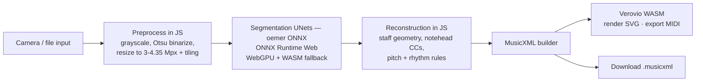

# Optical Music Recognition — Literature Review & Implementation Plan

*Compiled 2026-07-16. Sources were fetched and claim-checked against primary sources (arXiv papers, GitHub repositories, official docs); a few items noted below are unverified.*

## 1. Academic state of the art

### 1.1 Classical pipelines (pre-≈2016)

Traditional OMR is a multi-stage pipeline: binarization → staff-line detection/removal →
symbol segmentation → symbol classification → notation reconstruction (semantics: pitch,
rhythm, voices). The canonical survey is Calvo-Zaragoza, Hajič & Pacha, *Understanding
Optical Music Recognition* (ACM Computing Surveys, 2020). The weakness of the classical
approach is error propagation: a mistake in staff removal corrupts every later stage.

**Audiveris** is the surviving production example of this school — a *hybrid* pipeline
(ad-hoc line detection, morphological operations for beams, template matching for note
heads, a small neural net for fixed-size shapes, Tesseract for text). Its own docs state
that 100% recognition is out of reach and ship a manual correction editor — a realistic
expectation to carry into any app design.

### 1.2 End-to-end deep learning

A 2025 survey (Castellanos, Gallego & Fujinaga, *Deep Learning for Optical Music
Recognition: A Review*, TechRxiv preprint, Feb 2025) documents the field-wide shift:
every classical stage, and OMR as a whole, is now done with deep learning.

Key milestones (all claim-checked against the papers):

| Year | System | Architecture | Scope | Reported accuracy |
|------|--------|-------------|-------|-------------------|
| 2018 | **Camera-PrIMuS** (Calvo-Zaragoza & Rizo, ISMIR) | CRNN (4 conv + 2 BLSTM) + CTC | Monophonic, printed, camera-distorted | ~2% symbol error rate (SER) |
| 2023 | **TrOMR** (NetEase, ICASSP) | Transformer image-to-sequence | Polyphonic, real camera photos | Outperforms prior work on real-world photos; basis of homr |
| 2023 | **e2e-pianoform** (Ríos-Vila et al., IJDAR) | CNN encoder + Transformer decoder | Pianoform (grand staff) | SER 5.8% clean / 6.5% distorted (GrandStaff) |
| 2024 | **SMT** (Ríos-Vila et al., ICDAR) | Transformer img2seq, 2D positional encoding, **kern output | Polyphonic without monophonic tricks | CER 3.9% / SER 5.1% (GrandStaff); SER 1.4% (Quartets) |
| 2024 | **SMT++** (arXiv 2405.12105) | Same + curriculum training | **Full page** pianoform, no layout-analysis step | CER 5.6% / SER 6.9% (FP-GrandStaff) |
| 2024 | **"Zeus" / OLiMPiC** (arXiv 2403.13763) | CNN + BLSTM + attention LSTM (deliberately no transformer), Linearized MusicXML output | Pianoform, real scans | SER 2.77% on GrandStaff (≥50% better than transformers); **18.4% TEDn on real scans even with heavy augmentation** |

Two important calibration points:

1. **The synthetic-to-real gap is the dominant problem.** Camera-PrIMuS showed models
   trained on clean images collapse on distorted ones (SER 44–60%); training on distorted
   data fixes both. The OLiMPiC paper showed even a state-of-the-art model goes from
   13.7% → 44.4% error when moving from synthetic renders to flatbed scans (18.4% with
   augmentation) — and scans are *easier* than phone photos.
2. **Standardized benchmarks are sobering.** The Sheet Music Benchmark (SMB, arXiv
   2506.10488, 2025; 685 real pages) reports SMT at **SER 31.4% on pianoform and 57.1% on
   monophony** — far worse than the papers' own synthetic-test numbers. Treat all OMR
   output as a draft requiring manual correction.

Also note: SER numbers are **not comparable across output encodings** (kern vs ekern vs
Linearized MusicXML give wildly different SER on the same model). The encoding-independent
metric is TEDn (tree edit distance on MusicXML).

### 1.3 Datasets

| Dataset | Content | Size | Notes |
|---------|---------|------|-------|
| **PrIMuS / Camera-PrIMuS** | Printed monophonic incipits | 87,678 | Clean + camera-distorted renders; MEI + semantic/agnostic encodings |
| **MUSCIMA++** | Handwritten | 140 fully annotated pages (of 1,000) | The handwritten reference; small |
| **DeepScoresV2** | Typeset symbol detection | 255,385 images / 151M symbols / 135 classes | CC-BY 4.0, Zenodo; object detection oriented |
| **DoReMi** | Typeset (Dorico-generated) | 6,432 images / ~1M objects / 94 classes | Ships MusicXML + MEI + MIDI ground truth |
| **GrandStaff** | Pianoform systems | 53,882 | Synthetic renders + distorted variants; kern/bekern |
| **FP-GrandStaff** | Full pages | 688 pages | For SMT++ |
| **OLiMPiC** | Pianoform (OpenScore Lieder) | 15k synthetic train + real IMSLP scan test sets | CC BY-SA; the "hard" realistic benchmark; Linearized MusicXML |
| **SMB** | Mixed textures, real pages | 685 pages | 2025 standardized evaluation benchmark, **kern ground truth |

### 1.4 Known limitations (field-wide)

- Printed ≫ handwritten (most systems fail on handwritten altogether).
- Scans ≫ phone photos (lighting, 3D page curvature).
- Monophonic ≫ polyphonic/pianoform ≫ dense orchestral.
- Dynamics, articulations, lyrics, tuplets are weak spots even in the best systems
  (homr explicitly ignores dynamics/articulation; tuplets account for a measurable
  chunk of residual error in the OLiMPiC work).

## 2. Open-source OMR software status (July 2026)

| Project | License | Runtime | Status (2026) | Browser-portable? |
|---------|---------|---------|---------------|-------------------|
| **Audiveris** | AGPL-3.0 | Java + Tesseract | Very active (v5.11.0, Jul 2026, 2.6k★) | ❌ No realistic path (Java, hybrid pipeline) |
| **oemer** | **MIT** | Python, **ONNX Runtime by default** | Low activity (last release v0.1.8, Nov 2024); README points to homr as successor | ✅ **Yes — models are already ONNX**; proven by QuickStave (commercial in-browser OMR built on oemer's nets) |
| **homr** | AGPL-3.0 | Python 3.11 / PyTorch | Active (release Jun 2026, 323★) | ✅ Proven on-device by **Andromr** (Android: segmentation + transformer-encoder via TFLite, decoder via ONNX Runtime, ~30 s/page on a phone) |
| **Mozart, cadenCV, SheetVision** | various | Python classical CV | Effectively abandoned (unverified — not re-checked this pass) | Only as algorithm references |

Architecture notes:

- **oemer**: two UNet segmentation models (staffline/symbol separation, then symbol
  types) + SVM classifiers + rule-based reconstruction → MusicXML. Printed Western
  notation only; slow in its Python form (minutes/page even with GPU).
- **homr**: reuses oemer's UNet segmentation, replaces recognition with a
  Polyphonic-TrOMR-style transformer per staff → MusicXML. Designed for **camera
  photos**. Scope limited to pitch + rhythm on treble/bass clefs.
- A third-party benchmark repo (notes2tone, Mar 2026) compares exactly Audiveris vs
  homr vs oemer on SMB — these three are the de-facto open-source contenders.
- The GitHub `optical-music-recognition` topic has ~58 repos, ~3 TypeScript / 1 JS —
  **there is essentially no browser-native open-source OMR today**. That's the gap
  this app fills.

## 3. Running OMR in the browser

### 3.1 Inference runtimes

| Runtime | Backend | Notes |
|---------|---------|-------|
| **ONNX Runtime Web** | WASM (CPU) + **WebGPU** EP | The default choice. WebGPU is out-of-the-box in Chrome/Edge (Windows/macOS/Android); Firefox/Safari support still partial → always keep the WASM fallback. Graph-capture optimization needs static shapes. |
| **TensorFlow.js** | WebGL/WebGPU/WASM | Viable but requires model conversion from ONNX/PyTorch; ecosystem momentum is with ORT-web. |
| **transformers.js** | wraps ORT-web | Only worth it if a model is packaged for it; adds convenience for autoregressive decoding + quantized dtypes. |
| **Rust → WASM** (tract, burn, candle) | WASM/WebGPU | Fits the Rust preference; realistic for the *preprocessing* stage (binarization, deskew, dewarping, connected components) and possibly UNet inference, but off the beaten path for transformer decoders. |
| **OpenCV.js / hand-rolled JS** | WASM | For classical CV fallback / preprocessing only. |

### 3.2 Feasibility evidence

- **QuickStave** (commercial, closed) runs OMR fully client-side in the browser —
  built on oemer's MIT models, "seconds per page". Direct existence proof for the goal.
- **Andromr** (AGPL, open) runs the full homr pipeline offline on Android phones at
  ~30 s/page, having converted homr's models to TFLite + ONNX. Direct proof that
  homr's models convert and fit consumer hardware.
- Model sizes (verified from the oemer release): `1st_model.onnx` (staff/symbol UNet)
  **70.8 MB**, `2nd_model.onnx` (symbol-type UNet) **38.4 MB** — ~110 MB total,
  acceptable for an offline-capable PWA with cached models; int8 quantization can
  shrink this substantially later.

### 3.3 oemer model interface (verified from oemer 0.1.8 source)

| Model | Input | Output | Classes (argmax) |
|-------|-------|--------|------------------|
| `unet_big` (1st) | `(N, 256, 256, 3)` RGB | `(N, 256, 256, 3)` | 0 background · 1 staff line · 2 symbol |
| `seg_net` (2nd) | `(N, 288, 288, 3)` RGB | `(N, 288, 288, 4)` | 0 background · 1 stems/rests · 2 notehead · 3 clefs/keys |

Inference protocol: resize page to ~3.0–4.35 Mpixels, slide a window (window = model
input size, step 128 px), batch the tiles, average overlapping predictions, argmax to
a per-pixel class map. Input tensor name `input`; outputs `prediction` / `conv2d_25`.

## 4. Output formats & rendering

Formats:
- **MusicXML** — the interchange standard (MuseScore/Sibelius/Dorico). Primary export.
- **MEI** — scholarly standard; Verovio's native format.
- **\*\*kern** (Humdrum) — compact token vocabulary; what SMT-family models emit.
- **MIDI** — playback only; cannot store layout or enharmonic spelling — never sufficient as the sole output.

Renderers (all open source, all actively maintained in 2026):

| Library | License | Input | Notes |
|---------|---------|-------|-------|
| **Verovio** | LGPL-3.0 | MEI native; **imports MusicXML, \*\*kern, ABC, PAE**; exports MIDI | C++20 → **WASM on npm**, ESM build works with Vite; v6.2.0 (May 2026). Humdrum support adds ~⅓ to bundle size. |
| **OpenSheetMusicDisplay** | BSD-3 | MusicXML / .mxl | TypeScript on top of VexFlow; v2.0.0 (Jun 2026, 1.9k★). Some notation gaps (cross-staff slurs, 2-note tremolo). |
| **VexFlow** | MIT | JS API only (no MusicXML) | Low-level engraving primitives; use via OSMD rather than directly. |

## 5. Implementation plan (decided 2026-07-16)

**Decisions** (options considered in §5.6):
- **Recognition engine: oemer's ONNX models** (Option A) — MIT license, models already
  ONNX, browser feasibility proven by QuickStave. The engine sits behind a swappable
  interface so homr's transformer (Option B) can be added later.
- **Renderer: Verovio WASM** — one LGPL library renders MusicXML, converts formats,
  and exports MIDI; ESM build on npm works with Vite.
- **Stack**: Vue 3 + Vite PWA, JavaScript, biome formatting, vitest tests, pre-commit
  hook running fast tests + format check (per `TOOLS.md`).

### 5.1 Architecture

Everything runs offline after first load: model files are served with the app and
cached (Cache API / service worker); no image data ever leaves the device.

### 5.2 Pipeline stages

1. **Input** — file upload or `getUserMedia` camera capture, drawn to an offscreen canvas.
2. **Preprocess** (pure JS, testable): RGB extraction → resize into the 3–4.35 Mpx
   window oemer expects → 256/288 px tiles with 128 px step.
3. **Segmentation** (ONNX Runtime Web): run the two UNets per §3.3, average overlaps,
   argmax, stitch tiles into full-page label maps. WebGPU EP when available, WASM otherwise.
4. **Reconstruction** (pure JS, the real porting work): staff-line geometry from the
   staff map → group lines into staves; connected components on the notehead map →
   notehead positions; pitch from vertical position vs staff geometry + clef;
   duration from stem/beam evidence (start: quarter-note default, refine iteratively);
   assemble measures.
5. **Output**: MusicXML builder → Verovio renders SVG preview + exports MIDI;
   raw `.musicxml` download.
6. **Correction editor** (early, not last): the literature is unanimous that OMR
   output is a draft — click a note to fix pitch/duration before export.

### 5.3 Phases

| Phase | Deliverable |
|-------|-------------|
| **0** | Scaffold: Vite + Vue 3, biome, vitest, git + pre-commit hook |
| **1** | App shell: image input → preprocess → *stub* engine (classical CV) → MusicXML → Verovio render/export. End-to-end plumbing works before any ML. |
| **2** | oemer ONNX models in ORT-web: model fetch + cache, tiled inference, label maps. |
| **3** | Reconstruction port: staves, noteheads, pitch; MusicXML with real content. |
| **4** | Quality/UX: durations, accidentals, clef classification, correction editor, PWA offline manifest, quantized models, WebGPU path. |
| **5** | Second engine: homr's transformer via ONNX (Option B) for camera-photo robustness. |

### 5.4 Risks

- **Reconstruction complexity** — oemer's Python reconstruction is the bulk of its
  smarts; port incrementally (pitch first, rhythm later) rather than all at once.
- **Model size/latency** — 110 MB download, seconds-to-minutes inference on weak
  devices; mitigate with caching, quantization, WebGPU, and progress UI.
- **Scope honesty** — printed Western notation only; photos work worse than scans;
  handwritten is out of scope (field-wide unsolved).

### 5.5 Licenses

oemer models: MIT. Verovio: LGPL-3.0 (used as an unmodified library — fine). ONNX
Runtime Web: MIT. This app: MIT.

### 5.6 Options considered

- **A — oemer ONNX in browser** *(chosen)*: MIT, models already ONNX, proven in-browser
  (QuickStave); printed music only; reconstruction must be reimplemented in JS.
- **B — homr port** *(deferred to Phase 5)*: best open-source accuracy on camera photos,
  polyphonic, active; but AGPL-3.0 and heavier conversion work (autoregressive
  transformer decoding in browser, ~30 s/page on phones per Andromr).
- **C — SMT-family research model**: cleanest architecture, tiny decoder, but 31–57%
  SER on real pages (SMB benchmark) and training infrastructure needed — experiment,
  not product.
- **D — classical CV only**: tiny bundle but low ceiling; survives as the preprocessing
  stage and as a no-download stub engine for development.

## Key sources

- Calvo-Zaragoza, Hajič, Pacha — *Understanding Optical Music Recognition*, ACM Computing Surveys 2020
- Castellanos, Gallego, Fujinaga — *Deep Learning for OMR: A Review*, TechRxiv preprint, Feb 2025
- Calvo-Zaragoza, Rizo — *Camera-PrIMuS*, ISMIR 2018 · https://grfia.dlsi.ua.es/primus/
- TrOMR, ICASSP 2023 · arXiv:2308.09370 · https://github.com/NetEase/Polyphonic-TrOMR
- Ríos-Vila et al. — pianoform e2e, IJDAR 2023 · https://github.com/multiscore/e2e-pianoform
- SMT, ICDAR 2024 · arXiv:2402.07596 — SMT++ · arXiv:2405.12105
- *Practical End-to-End OMR for Pianoform Music* (OLiMPiC / Linearized MusicXML) · arXiv:2403.13763
- Sheet Music Benchmark · arXiv:2506.10488 (2025)
- DoReMi · arXiv:2107.07786 — DeepScoresV2 · ICPR 2020, Zenodo 4012193
- https://github.com/Audiveris/audiveris · https://github.com/BreezeWhite/oemer · https://github.com/liebharc/homr · https://github.com/aicelen/Andromr
- ONNX Runtime Web WebGPU docs · https://onnxruntime.ai/docs/tutorials/web/ep-webgpu.html
- https://github.com/rism-digital/verovio · https://github.com/opensheetmusicdisplay/opensheetmusicdisplay
- QuickStave (existence proof, closed source) · https://www.quickstave.com/optical-music-recognition
