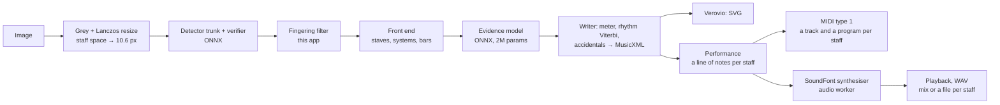

# MusicOCR

Fully client-side Optical Music Recognition (OMR) web app: photograph or upload
printed sheet music, get MusicXML and MIDI — everything runs in the browser,
no image ever leaves the device.

See [`LITERATURE_REVIEW.md`](LITERATURE_REVIEW.md) for the research behind the
design (§6–7 for the November 2026 update and the current plan).

## This fork: from sheet music to MIDI to audio

This is a fork of
[pauldubois98/OpticalMusicRecognition](https://github.com/pauldubois98/OpticalMusicRecognition)
(MusicOCR). It builds on the recognizer to reach the application specified in
[`docs/SPECIFICATION.md`](docs/SPECIFICATION.md) (in French): photograph a
score, get a MIDI file with a track per staff, then render it as audio with an
instrument chosen for each staff. The test plan that will settle the open
measurements is in [`docs/BANC-D-ESSAI.md`](docs/BANC-D-ESSAI.md). Both
documents are the specification as exported on 11 November 2026; this table is
where the code stands against it.

| Specification | Status |
|---------------|--------|
| Capture, page clean-up, several pages (F1–F5) | From MusicOCR; PDF and HEIC import not done |
| Recognition (F6–F10) | From MusicOCR (copista-2m, copista-28m); no confidence per bar yet |
| Correction (F11–F14) | From MusicOCR |
| Play the selected bar (F15) | Not done |
| MIDI type 1, a track and a program per staff; MusicXML; repeats (F16–F18) | Done (`src/audio/`) |
| Instrument per staff, preview, default by range, mixer, range warning, tempo, reverb, transposition (F19–F24) | Done |
| WAV export, mix or a file per staff (F25) | Done; MP3 not done |
| Instrument presets (F26) | Done (kept in the browser) |
| Projects, sharing (F27–F28) | Not done |
| Offline use as an installable app, French interface | Not done (the audio panel alone is in French) |

What has been checked: the unit tests (`tests/audio.test.js`), the pitch of
each of the 18 instruments by measurement, and the audio worker in headless
Chrome. What has not: the audio panel in a browser on a real device (Safari
and Android included), and the sound by ear. The test plan's measurements on
real scores have not been run.

## Architecture

The recognizer is a JavaScript port of
[copisteria](https://github.com/kobimusic/copisteria) (KobiMusic, Apache-2.0):
a symbol detector finds every notation symbol with its attributes, a
geometry-only front end finds staves, systems and bars, a small transformer
(the *evidence model*) reads every symbol in the context of neighbouring
systems, and a writer decodes rhythm, accidentals and meter into MusicXML.
The three networks run in **ONNX Runtime Web** (WebGPU for the detector trunk
when available, WASM otherwise) inside a Web Worker. Verovio (WASM) renders
the result.



## Audio

Under the score, each staff gets an instrument (18 are offered, in five
families), a volume and a pan, with mute and solo; tempo, transposition and
reverb are set for the whole score. `src/audio/` reads the MusicXML as it is
played (repeats, endings, da capo and dal segno unfolded on request, ties
joined), writes the MIDI file itself (Verovio's does not carry the chosen
instruments) and renders the sound with its own SoundFont player, in plain
JavaScript, in a Web Worker: a three-minute string quartet renders in about
two seconds on a desktop. The sound bank (≈ 12.6 MB, kept in the Cache API) is
cut from GeneralUser GS by `npm run fetch:soundfont`. The bank's modulators
and LFOs are not played; MP3 export is not there yet.

Two detector sizes are offered: **copista-2m** (default, ≈16 MB of models)
and **copista-28m** (≈124 MB, better pitch accuracy).

Without the app's addition (`upstream: true`) the port reproduces copisteria's
Python output byte for byte — checked on the test pages, a high-resolution
photo and a clean render. The addition, `src/pipeline/copisteria/fingerings.js`,
drops fingering digits that the detector reads as tuplet numbers (see the
file's header for the engraving rules it relies on).

## Development

```bash
npm install
npm run fetch:models   # needs uv: clones copisteria (pinned), downloads the
                       # copista weights and exports them to public/models/*.onnx
npm run fetch:soundfont # needs git: GeneralUser GS (pinned), cut down to
                       # public/soundfonts/catalogue.sf2
npm run dev            # http://localhost:3000
```

```bash
npm test               # vitest unit tests (+ a parity test when references exist)
npm run e2e            # recognize the 3 test pages in node and score them
npm run lint:fix       # biome format + lint
npm run build          # production build in dist/
```

Parity references against the Python original:
`uv run scripts/models/dump_reference.py test_images/*.png` (writes
`out/parity/`), then `node scripts/e2e-test.mjs --upstream …` reproduces them.

Enable the pre-commit hook (biome + fast tests):

```bash
git config core.hooksPath .githooks
```

## Deployment (GitHub Pages)

`.github/workflows/pages.yml` builds and deploys on every push to `main`. The
models are not committed: the workflow exports them
(`npm run fetch:models`, cached on the export script's hash, so it only reruns
when the pinned copisteria commit changes) and ships them in the site's
`models/` folder. One-time setup: *Settings → Pages → Source: GitHub Actions*.
`.github/workflows/ci.yml` lints, tests and builds every other branch.

- `BASE_PATH` (set by the workflow to `/<repo>/`) is the site's path.
- `VITE_MODELS_URL` (optional, at build time) loads the models from another
  host instead, e.g. if Pages refuses the 106 MB `copista-28m-trunk.onnx`.
- Pages cannot send COOP/COEP headers; `public/coi-serviceworker.js` adds them
  (one automatic reload on the first visit) so ONNX Runtime can use threads.
- Browsers keep the models in the Cache API under a name derived from
  `copista-meta.json`: a deploy with re-exported models replaces them.

## Evaluation

`test_images/` holds three phone photos of Clementi's Sonatina Op. 36 No. 2,
III (low resolution, pencil and coloured annotations); `test_images/reference/`
holds the public-domain WIMA MIDI and the page → bar mapping.
`scripts/eval/score.mjs` scores any MusicXML per page and hand: pitch F1, pitch +
rhythm F1 (inter-onset intervals) and an OMR-NED-style edit distance.

| Engine | Pitch F1 | Pitch + rhythm F1 |
|--------|---------:|------------------:|
| v0.2 (oemer UNets + JS rules) | 36.7 | 1.3 |
| copisteria upstream, copista-2m | 97.6 | 84.0 |
| **this app, copista-2m** | **97.9** | **94.7** |
| this app, copista-28m | 99.0 | 93.0 |

## Licenses

App: MusicOCR's code is MIT (`LICENSES/MusicOCR-MIT.txt`); this fork's
additions are Apache-2.0 (`LICENSE`), file by file as `NOTICE` lists.
copisteria code and copista weights: Apache-2.0 (see `NOTICE` and
`LICENSES/`). Verovio: LGPL-3.0. ONNX Runtime Web: MIT. Sound bank: cut from
GeneralUser GS by S. Christian Collins, under its own licence
(`LICENSES/GeneralUser-GS.txt`).
