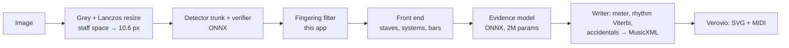

# MusicOCR

Fully client-side Optical Music Recognition (OMR) web app: photograph or upload
printed sheet music, get MusicXML and MIDI — everything runs in the browser,
no image ever leaves the device.

See [`LITERATURE_REVIEW.md`](LITERATURE_REVIEW.md) for the research behind the
design (§6–7 for the November 2026 update and the current plan).

## Architecture

The recognizer is a JavaScript port of
[copisteria](https://github.com/kobimusic/copisteria) (KobiMusic, Apache-2.0):
a symbol detector finds every notation symbol with its attributes, a
geometry-only front end finds staves, systems and bars, a small transformer
(the *evidence model*) reads every symbol in the context of neighbouring
systems, and a writer decodes rhythm, accidentals and meter into MusicXML.
The three networks run in **ONNX Runtime Web** (WebGPU for the detector trunk
when available, WASM otherwise) inside a Web Worker. Verovio (WASM) renders
the result and exports MIDI.



Two detector sizes are offered: **copista-2m** (default, ≈16 MB of models)
and **copista-28m** (≈124 MB, better pitch accuracy).

Without the app's addition (`upstream: true`) the port reproduces copisteria's
Python output byte for byte — checked on the test pages, a high-resolution
photo and a clean render. The addition, `src/pipeline/copisteria/fingerings.js`,
drops fingering digits that the detector reads as tuplet numbers (see the
file's header for the engraving rules it relies on).

## Development

```bash
npm install
npm run fetch:models   # needs uv: clones copisteria (pinned), downloads the
                       # copista weights and exports them to public/models/*.onnx
npm run dev            # http://localhost:3000
```

```bash
npm test               # vitest unit tests (+ a parity test when references exist)
npm run e2e            # recognize the 3 test pages in node and score them
npm run lint:fix       # biome format + lint
npm run build          # production build in dist/
```

Parity references against the Python original:
`uv run scripts/models/dump_reference.py test_images/*.png` (writes
`out/parity/`), then `node scripts/e2e-test.mjs --upstream …` reproduces them.

Enable the pre-commit hook (biome + fast tests):

```bash
git config core.hooksPath .githooks
```

## Deployment (GitHub Pages)

`.github/workflows/pages.yml` builds and deploys on every push to `main`. The
models are not committed: the workflow exports them
(`npm run fetch:models`, cached on the export script's hash, so it only reruns
when the pinned copisteria commit changes) and ships them in the site's
`models/` folder. One-time setup: *Settings → Pages → Source: GitHub Actions*.

- `BASE_PATH` (set by the workflow to `/<repo>/`) is the site's path.
- `VITE_MODELS_URL` (optional, at build time) loads the models from another
  host instead, e.g. if Pages refuses the 106 MB `copista-28m-trunk.onnx`.
- Pages cannot send COOP/COEP headers; `public/coi-serviceworker.js` adds them
  (one automatic reload on the first visit) so ONNX Runtime can use threads.
- Browsers keep the models in the Cache API under a name derived from
  `copista-meta.json`: a deploy with re-exported models replaces them.

## Evaluation

`test_images/` holds three phone photos of Clementi's Sonatina Op. 36 No. 2,
III (low resolution, pencil and coloured annotations); `test_images/reference/`
holds the public-domain WIMA MIDI and the page → bar mapping.
`scripts/eval/score.mjs` scores any MusicXML per page and hand: pitch F1, pitch +
rhythm F1 (inter-onset intervals) and an OMR-NED-style edit distance.

| Engine | Pitch F1 | Pitch + rhythm F1 |
|--------|---------:|------------------:|
| v0.2 (oemer UNets + JS rules) | 36.7 | 1.3 |
| copisteria upstream, copista-2m | 97.6 | 84.0 |
| **this app, copista-2m** | **97.9** | **94.7** |
| this app, copista-28m | 99.0 | 93.0 |

## Licenses

App: MIT. copisteria code and copista weights: Apache-2.0 (see `NOTICE` and
`LICENSES/`). Verovio: LGPL-3.0. ONNX Runtime Web: MIT.
